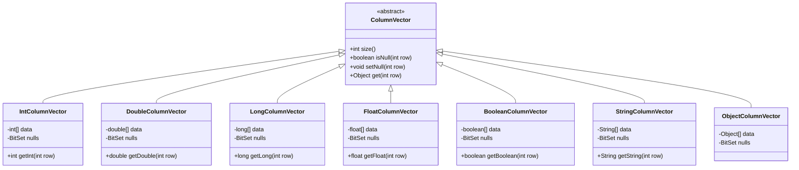

# Columnar Engine & Memory Layout

Traditional Java DataFrame implementations typically represent tables as `List<Map<String, Object>>` or arrays of boxed objects (`Object[]`). While flexible, this approach incurs substantial overhead:
1. **Per-cell heap allocation**: Every single primitive (`int`, `double`, `boolean`) is boxed into an `Integer`, `Double`, etc.
2. **Poor cache locality**: Row objects are scattered unpredictably across the JVM heap.
3. **High garbage collection pressure**: Hundreds of thousands of short-lived objects.

**CupOfTea** uses a dedicated **Columnar Engine** (`ColumnVector`) architecture.

---

## 🏗️ Architecture



---

## 🚀 Key Advantages

### 1. Primitive Contiguous Storage
- Data is stored in typed Java primitive arrays (`int[]`, `double[]`, `long[]`, `float[]`, `boolean[]`).
- Reads and iterations operate directly on continuous memory segments, maximizing L1/L2 CPU cache prefetching.

### 2. Space-Efficient Null Bitmasks
- Missing values are tracked using a compact `java.util.BitSet`.
- Rather than setting object pointers to `null`, a single bit per row indicates whether a value is present or absent.
- 1 million rows require only ~122 KB of null bitmask memory per column.

### 3. Minimized GC Pressure
- Primitive arrays are allocated in chunks. Transforming or filtering columnar vectors creates far fewer object allocations, dramatically easing JVM GC pauses on large datasets.

### 4. Zero-Allocation GroupBy Engine
- Traditional dataframe grouping creates millions of heap objects (`Map<List<Object>, List<Integer>>`).
- CupOfTea utilizes an open-addressing primitive hash table (`GroupHashTable`) storing representative row indices in contiguous `int[]` arrays.
- Aggregate reductions (`sum`, `mean`, `min`, `max`, `count`) accumulate single-pass updates directly into primitive arrays (`double[]`, `long[]`, `int[]`) and populate destination `ColumnVector` instances without boxing or creating row-level objects.

---

## ⚡ Direct Vector Access

The engine exposes typed vector methods directly to eliminate auto-unboxing in hot paths:

```java
IntColumnVector intVector = (IntColumnVector) column.getVector();
for (int i = 0; i < intVector.size(); i++) {
    if (!intVector.isNull(i)) {
        int val = intVector.getInt(i); // zero unboxing overhead
        // perform calculation
    }
}
```
