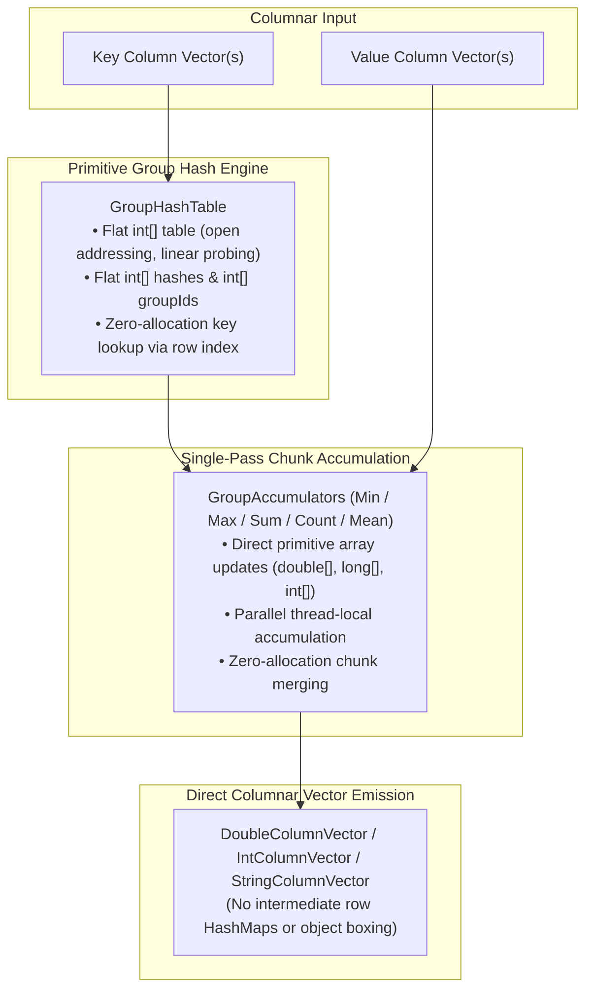

# GroupBy & Aggregations

CupOfTea features a high-performance, cache-conscious GroupBy engine powered by primitive open-addressing hash tables, single-pass chunk accumulation, and direct columnar vector emission. It allows segmenting massive datasets by one or more keys and computing multiple summary metrics with minimal GC overhead.

---

## 🏗️ Architecture & Engine Design

Traditional JVM dataframe libraries group rows by building intermediate maps such as `Map<List<Object>, List<Integer>>` or `Map<Key, RowSet>`. On datasets with millions of rows, this produces:
1. Millions of temporary `List<Object>` / `Tuple` composite key allocations.
2. Millions of boxed objects (`Integer`, `Double`, etc.) and `LinkedHashMap.Entry` nodes.
3. Severe memory fragmentation, pointer chasing, and heavy GC pauses.
4. Multiple cache-unfriendly passes over source columns for each aggregate metric.

CupOfTea solves this with three core architectural components introduced in Issue [#210](https://github.com/cupoftea-labs/cupoftea/issues/210):



### 1. Primitive Open-Addressing Hash Table (`GroupHashTable`)
- Uses power-of-2 capacity with linear probing and flat primitive arrays: `int[] table`, `int[] hashes`, and `int[] groupIds`.
- Keys are compared directly against previous rows in the source column vectors using their integer row index. **No composite key objects (`List<Object>` or `Tuple`) are allocated on key lookups.**
- Highly optimized single-key specializations (`String`, `Integer`, `Long`, `Double`) bypassing general array lookups.
- Memory footprint is only ~12 bytes per slot in flat arrays.

### 2. Single-Pass Chunk Accumulation (`GroupAccumulator`)
- Standard aggregations (`count`, `sum`, `mean`/`avg`, `min`, `max`, `listAgg`) implement the `GroupAccumulator` interface.
- Each chunk data buffer is traversed **once**: for each row, the group ID is identified from `GroupHashTable` and all active accumulators update their internal primitive arrays (`double[]`, `long[]`, `int[]`) directly in CPU L1/L2 cache.
- In multi-threaded execution (`df.asParallel()`), worker threads accumulate independently on data chunks without lock contention, followed by a fast chunk merge.

### 3. Direct Columnar Vector Emission
- Output grouped vectors (`DoubleColumnVector`, `IntColumnVector`, `LongColumnVector`, `FloatColumnVector`, `StringColumnVector`) are allocated once with the exact cardinality (`numGroups`).
- Accumulators populate internal primitive buffers directly by group ID index without boxing (`double -> Double`) and without creating per-row `HashMap<String, Object>` containers.

---

## 👥 Grouping Data

To start a grouped query, call `df.groupBy(...)`:

```java
import com.cupoftea.CupOfTea;
import com.cupoftea.table.GroupBy;

CupOfTea df = CupOfTea.read().csv("sales.csv");

// Single-key grouping
GroupBy byDept = df.groupBy("department");

// Multi-key grouping
GroupBy byRegionAndDept = df.groupBy("region", "department");
```

---

## 📈 Aggregation Functions

The `com.cupoftea.table.Aggregations` class provides a rich suite of aggregate builders:

| Function | Alias | Single-Pass | Description |
| :--- | :--- | :---: | :--- |
| `Aggregations.count()` | — | ✅ | Total rows per group |
| `Aggregations.count("col")` | — | ✅ | Count non-null values in column |
| `Aggregations.sum("col")` | — | ✅ | Numeric sum (preserves `int`, `long`, `double`, `float`, `BigDecimal`) |
| `Aggregations.mean("col")` | `average()`, `avg()` | ✅ | Arithmetic mean (`double` / `BigDecimal`) |
| `Aggregations.min("col")` | `minimum()` | ✅ | Minimum value (supports primitives and `Comparable`) |
| `Aggregations.max("col")` | `maximum()` | ✅ | Maximum value (supports primitives and `Comparable`) |
| `Aggregations.listAgg("col", sep)` | `aggregate()` | ✅ | String concatenation joined by delimiter |
| `Aggregations.first("col")` | — | ❌ | First non-null value in group |
| `Aggregations.last("col")` | — | ❌ | Last non-null value in group |
| `Aggregations.median("col")` | — | ❌ | Median value using linear-time `Introselect` |
| `Aggregations.quantile("col", q)` | — | ❌ | Quantile `q` (0.0 to 1.0) |
| `Aggregations.variance("col")` | `var()` | ❌ | Sample variance (two-pass numerically stable) |
| `Aggregations.standardDeviation("col")` | `std()` | ❌ | Sample standard deviation |
| `Aggregations.skewness("col")` | — | ❌ | Fisher-Pearson skewness coefficient |
| `Aggregations.kurtosis("col")` | — | ❌ | Excess kurtosis |

---

## 💡 Practical Examples

### 1. High-Performance Multi-Metric Aggregation (1BRC Pattern)
Compute minimum, mean, maximum, and total counts over millions of records in a single pass:

```java
import com.cupoftea.CupOfTea;
import com.cupoftea.table.Aggregations;

CupOfTea measurements = CupOfTea.read().csv("measurements.txt");

CupOfTea result = measurements.asParallel()
    .groupBy("station")
    .aggregate(
        Aggregations.min("temperature").as("min_temp"),
        Aggregations.mean("temperature").as("mean_temp"),
        Aggregations.max("temperature").as("max_temp"),
        Aggregations.count().as("total_readings")
    );

result.print();
```

### 2. Multi-Column Grouping with Custom Aliases
```java
CupOfTea summary = df.groupBy("region", "category")
    .aggregate(
        Aggregations.count().as("order_count"),
        Aggregations.sum("revenue").as("total_revenue"),
        Aggregations.avg("revenue").as("avg_ticket"),
        Aggregations.median("delivery_days").as("median_delivery")
    );
```

### 3. String Aggregation (`listAgg`)
Concatenate group strings with a custom delimiter:
```java
CupOfTea tagsByArticle = df.groupBy("article_id")
    .aggregate(
        Aggregations.listAgg("tag", ", ").as("tags")
    );
```

---

## ⚡ Parallel Execution (`df.asParallel()`)

When grouping large DataFrames, calling `.asParallel()` partitions the underlying columnar vectors across worker threads.
Each worker thread builds a thread-local `GroupHashTable` and updates its thread-local `GroupAccumulator` instances:

```java
// Executes parallel multi-core aggregation using the common ForkJoinPool
CupOfTea fastSummary = df.asParallel()
    .groupBy("customer_id")
    .aggregate(
        Aggregations.sum("amount").as("total_spent"),
        Aggregations.count().as("trans_count")
    );

// Or provide a custom ExecutorService
CupOfTea customPoolSummary = df.parallel(customExecutor)
    .groupBy("customer_id")
    .aggregate(Aggregations.sum("amount").as("total_spent"));
```

---

## 🛡️ Null Value Semantics

Consistent with SQL and pandas standards:
- Missing/null values are automatically skipped during accumulation (`sum`, `mean`, `min`, `max`, `count(col)`).
- `Aggregations.count()` counts all rows in the group regardless of nulls.
- `Aggregations.count("col")` counts only non-null occurrences in that column.
- If all values in a group for a given column are null, `sum`, `mean`, `min`, and `max` return `null`.
